<h1 align="center">BLENDirector</h1>

<p align="center">
  <b>Reusable Scene Templates, Instant Videos | Blender 3.6 Add-on</b>
</p>

<p align="center">
  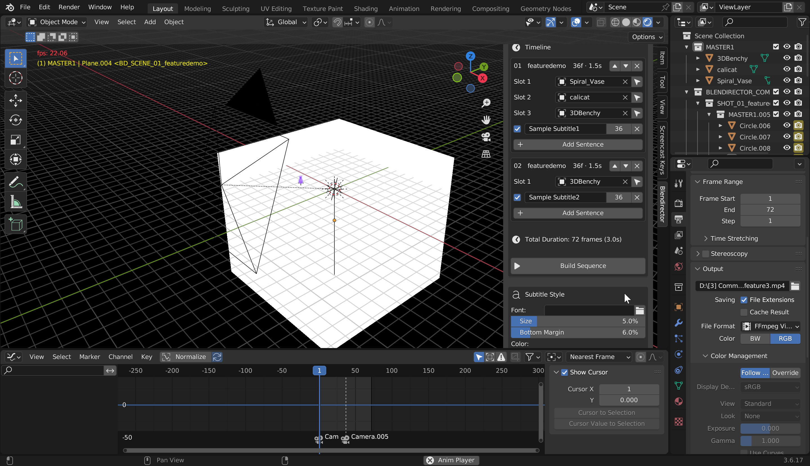
</p>

<p align="justify">
Introducing <b>BLENDirector</b> – unlocking new dimensions to supercharge your motion graphics workflow!
Create multiple animations effortlessly using a simple drag-and-drop mechanism. Render multiple .blend files simultaneously and explore a range of features designed to support a scalable motion graphics workflow.
With the freedom to use your own templates, the only limit is your imagination!
</p>

<p align="center">
  <b>Get it on: </b>
  <a href="https://ykreate.itch.io/blendirector-reusable-scene-templates-instant-videos-blender-36-add-on"><b>Itch.io</b></a>
</p>

## Features

- [Apply Animation](#apply-animation)
- [Apply Multi-Animation](#apply-multi-animation)
- [Multi Scene Export](#multi-scene-export)
- [Rearrange Scenes and Subtitles](#rearrange-scenes-and-subtitles)

### Apply Animation
#### 1. Create preset:
- Take copy of 'MasterTemplate.blend' file and open it 
- Animate 'product_slot' and 'scene_camera' empty as per requirements
<p align="left">
  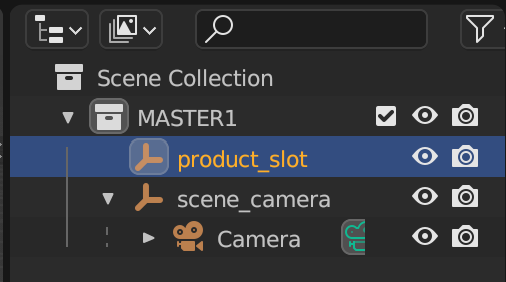
  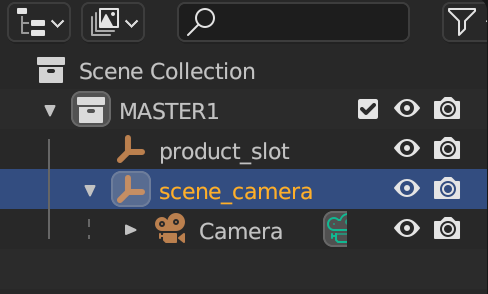
</p>

- Under 'Object Properties' tab, keep custom value 'product_slot_1'
<p align="left">
  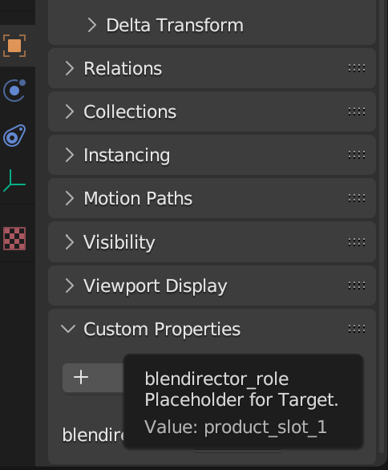
</p>

- Make sure 'scene_camera' empty has custom property as 'scene_camera'
<p align="left">
  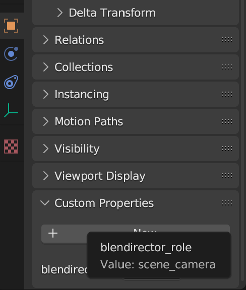
</p>

- Edit 'preset.json' file

```json
    {
    "name": "1_1_1_normal",
    "description": "intro_single_normalslideup",
    "author": "YKreate",
    "version": "1.0",
    "duration": 80 //exact duration in frames
    }
```

- Render the present as .mp4
- Keep '.blend' '.json' and '.mp4' files in same folder
#### 2. Use preset:
- Open new '.blend' file and import your model
- Under Blendirector tab go to 'Import External Preset'
<p align="left">
  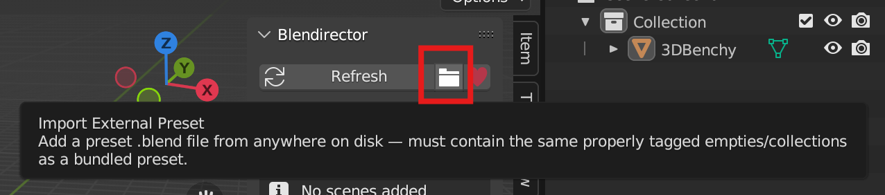
</p>

- Select your '.blend' file from folder
- Add it to timeline
<p align="left">
  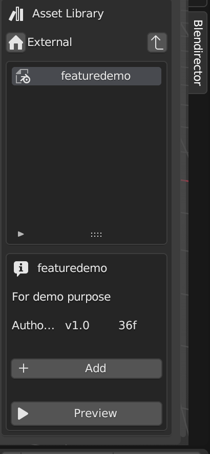
</p>

- Drag the model to respective slot
<p align="left">
  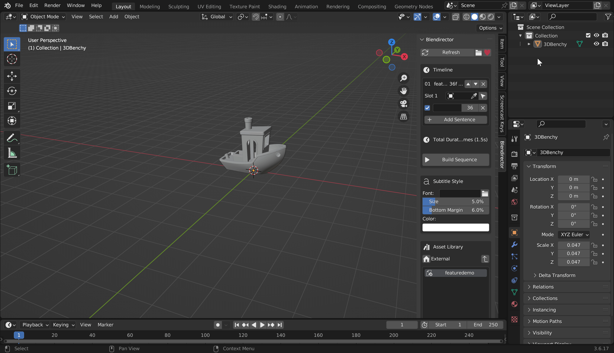
</p>

- Move the model in viewport aside so it wont come in camera view and hit 'Build Sequence'

### Apply Multi-Animation
#### 1. Create preset:
- Take copy of 'MasterTemplate.blend' file and open it 
- Make copies and animate 'product_slot' and 'scene_camera' empty as per requirements
<p align="left">
  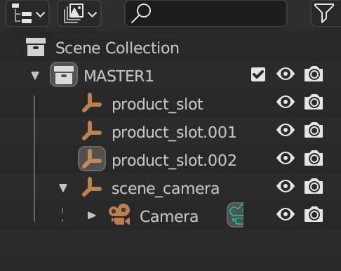
</p>

- Under 'Object Properties' tab, keep custom value 'product_slot_1' 'product_slot_2' 'product_slot_3' and so on for each 'product_slot' empty
<p align="left">
  
</p>

- Make sure 'scene_camera' empty has custom property as 'scene_camera'
<p align="left">
  
</p>

- Edit 'preset.json' file

```json
    {
    "name": "1_1_1_normal",
    "description": "intro_single_normalslideup",
    "author": "YKreate",
    "version": "1.0",
    "duration": 80 //exact duration in frames
    }
```

- Render the present as .mp4
- Keep '.blend' '.json' and '.mp4' files in same folder
#### 2. Use preset:
- Open new '.blend' file and import your model
- Under Blendirector tab go to 'Import External Preset'
<p align="left">
  
</p>

- Select your '.blend' file from folder
- Add it to timeline
<p align="left">
  
</p>

- Drag the model to respective slot
<p align="left">
  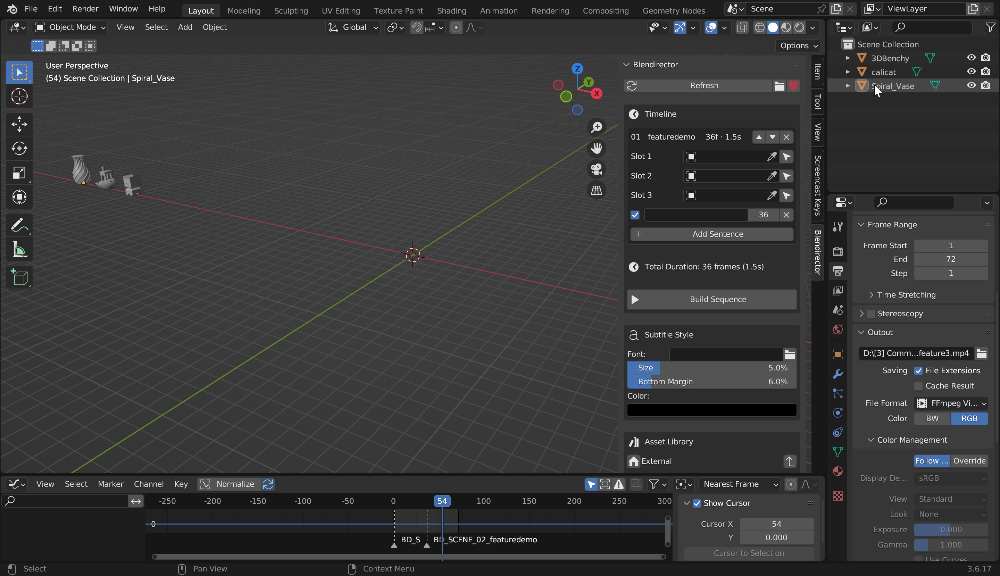
</p>

- Move the model in viewport aside so it wont come in camera view and hit 'Build Sequence'

### Multi Scene Export
- Add multiple presets to timeline and hit 'Build Sequence'
<p align="left">
  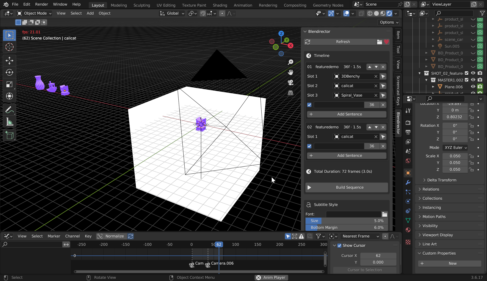
</p>

### Rearrange Scenes and Subtitles
- Click arrows to rearrange the imported presets and hit 'Build Sequence'
<p align="left">
  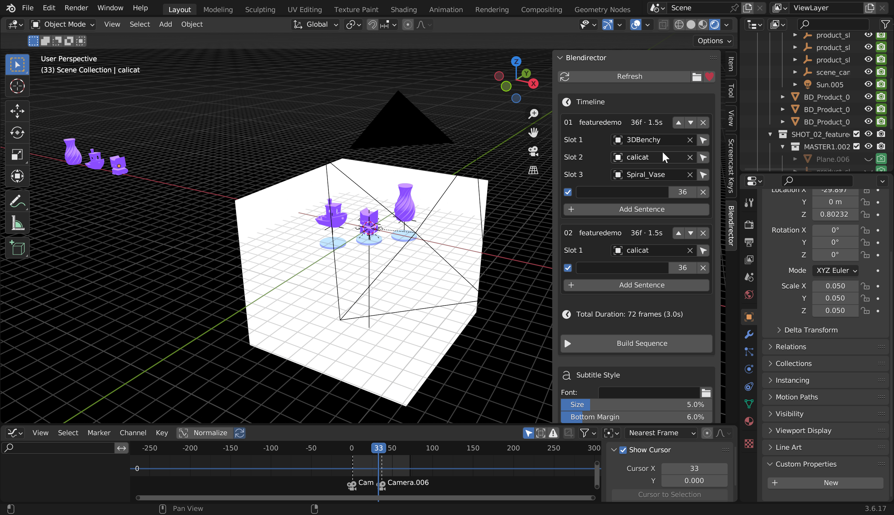
</p>

- Add Subtitles
<p align="left">
  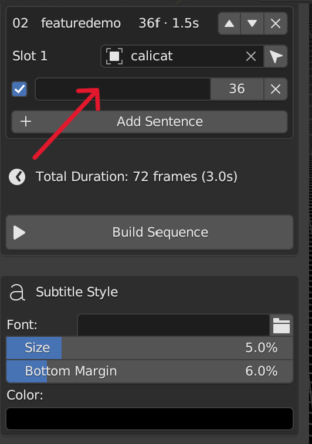
</p>

<p align="center">
  <b>Get it on: </b>
  <a href="https://ykreate.itch.io/blendirector-reusable-scene-templates-instant-videos-blender-36-add-on"><b>Itch.io</b></a>
</p>

## Author
Created by **YKreate**

- GitHub: [@yashkurade](https://github.com/yashkurade)
- YouTube: [link](https://www.youtube.com/@QUESTIONSPOT)